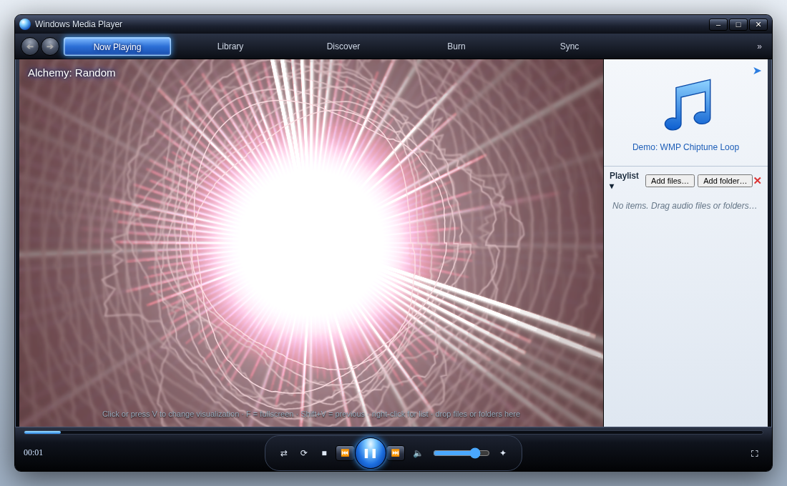
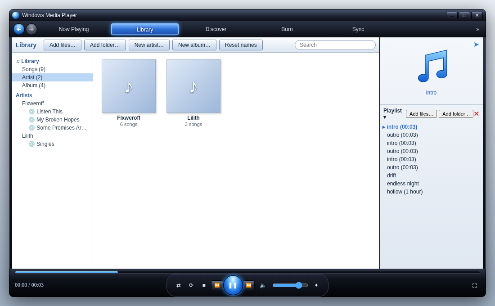
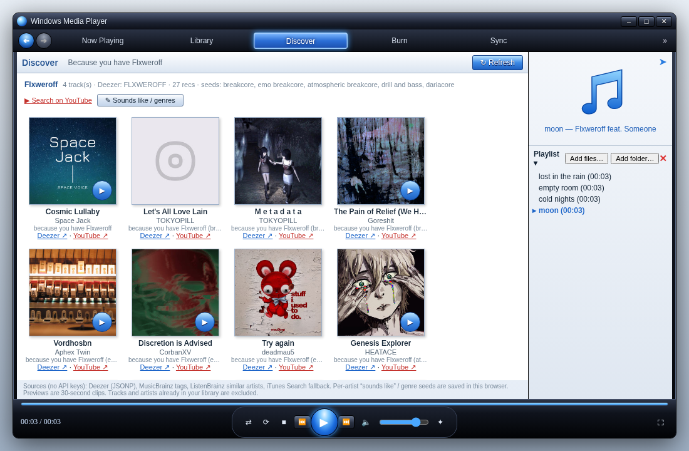
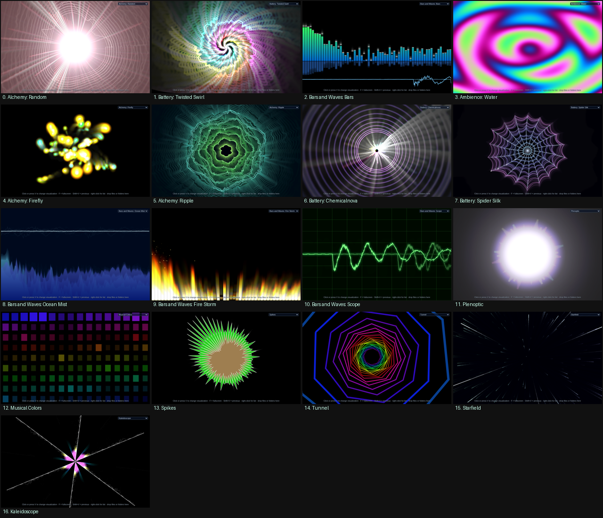

# Retro Media Player

An early-2000s style music player with audio-reactive visualizers — nostalgia edition.
One self-contained HTML file (no dependencies), plus a small Electron wrapper for Windows.



## Download for Windows

1. Go to the [latest release](https://github.com/WiegeleWigi/retro-media-player/releases/latest) and download **Retro-Media-Player-win-x64.zip**.
2. Right-click the zip → **Extract All…** (or use WinRAR / 7-Zip).
3. Open the extracted **Retro Media Player** folder.
4. Double-click **Retro Media Player.exe**.
5. Windows SmartScreen may warn because the app is unsigned: click **More info → Run anyway**.

No installation needed. Settings are stored in `%APPDATA%\Retro Media Player`.

## Use in the browser

Download or clone this repo and open `index.html` in Chrome, Edge or Firefox — or try it online at
<https://wiegelewigi.github.io/retro-media-player/>. Your music never leaves your computer.

## Features

- **Now Playing** with 17 audio-reactive visualizations (Alchemy, Battery, Bars and Waves, Plenoptic, Musical Colors, Spikes, Tunnel, Starfield, Kaleidoscope…); last preset is remembered
- Built-in chiptune demo track, so it works with no music loaded
- **Library**: artists → albums tree, album-art tiles, search, play album; reads MP3 ID3v1/v2 tags and cover art, falls back to folder names (`Artist/Album/`, `Artist - Album (Year)`, loose files → *Singles*)
- Add files or **whole folders** (button or drag-and-drop)
- Rename artists / albums / titles (right-click, ✎ or F2), create artists and albums, move tracks by drag-and-drop or *Move to…* — all remembered
- **Discover**: song recommendations for the artists in your library (Deezer, MusicBrainz/ListenBrainz, iTunes — no API keys), 30-second previews, links to Deezer and YouTube, and per-artist “sounds like” / genre seeds for underground artists
- **Burn** list with an 80-minute CD capacity bar and **Sync** to a pretend device (both export `.m3u` playlists)





## Keyboard shortcuts

| Key | Action |
|---|---|
| Space | Play / pause |
| V / Shift+V | Next / previous visualization (right-click the visualization for the full list) |
| F (or double-click) | Full screen |
| ← / → | Previous / next track |
| M | Mute |
| Enter | Play selected playlist item |
| F2 | Rename selected item in Library |

## Building the Windows app

```bash
cd desktop
npm install
node build.js win32   # → desktop/out/Retro Media Player-win32-x64
```

Tests: `cd tests && npm install && npm run media && npm run unit && npm run e2e` (needs ffmpeg and Chrome).

## Disclaimer

This is a fan project inspired by the look of classic media players. It is not affiliated with, endorsed by, or connected to Microsoft. Windows Media Player is a trademark of Microsoft Corporation.

## License

[MIT](LICENSE) © 2026 Nejc Wiegele
